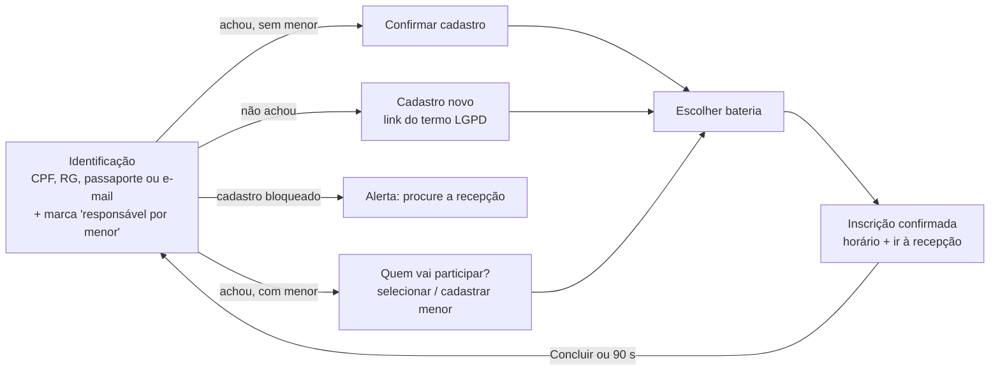

# Fluxo do totem (autoatendimento)

**Visual travado** (aprovado pelo dono). Este documento registra o fluxo para que nenhuma mudança futura o quebre.

## Regras de interface
- Tema escuro, alvos ≥ 64 px, fontes grandes, **teclado USB** ([teclado-totem](../03-componentes/teclado-totem.md)).
- Uma decisão por tela; botão principal sempre no mesmo lugar.
- "Voltar" em toda tela após a primeira; 90 s parado (com algo preenchido) volta ao início e limpa os dados.
- Mensagens de erro grandes, na própria tela, dizendo o que fazer.

## Regras de negócio (servidor)
`POST /api/totem/identificar` acha o cliente (inclui pré-cadastro feito pelo QR code); cadastro bloqueado não avança;
menores só com responsável; a inscrição reserva a vaga mas o pagamento e o termo assinado são na recepção.
