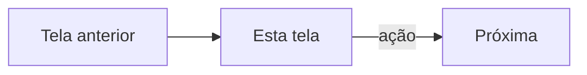

# {App} — {Nome da tela}

| | |
|---|---|
| Status | rascunho / aprovada em dd/mm/aaaa por … / implementada na versão … |
| Quem usa | |
| Tema | claro (operação) / escuro (público) |
| Padrão de tela | [link para 04-padroes-de-tela] |
| Desenho aprovado | `Nome.dc.html` |
| Arquivo(s) de código | |

## Objetivo
Uma ou duas frases.

## Fluxo

## Layout
Desenho em texto ou link, com as regiões numeradas.

## Interações
| # | Elemento | Gatilho | Resposta da interface | Efeito de negócio | Destino |
|---|---|---|---|---|---|

## Validações
| Campo | Regra | Momento | Mensagem |
|---|---|---|---|

## Estados
| Estado | Como aparece | Ação oferecida |
|---|---|---|
| Carregando | | |
| Vazio | | |
| Erro | | |
| Sem permissão | | |
| Off-line | | |

## Caminhos alternativos
-

## Regras
| Regra de interface | Regra de negócio |
|---|---|

## Teclado
Ordem de Tab: … · Enter: … · Esc: … · atalhos: …

## Responsividade
1920 / 1366 / 1280×720 / degradado: …

## Critérios de aceite
- [ ]

## Tokens e componentes
-
