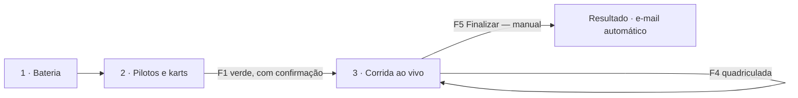

# Cronometragem — Ao vivo (passo 3 · Corrida)

| | |
|---|---|
| Status | implementada (documentação do comportamento atual) |
| Quem usa | cronometrista |
| Tema | claro |
| Padrão | [tela ao vivo](../../04-padroes-de-tela/tela-ao-vivo.md) |
| Desenho aprovado | `AoVivo.dc.html` |
| Código | `desktop/src/Kartodromo.Cronometragem/FormCrono.cs`, `FormCrono.AoVivo.cs`, `LiveGrid.cs` |

## Fluxo

## Interações
| # | Elemento | Gatilho | Interface | Negócio | Destino |
|---|---|---|---|---|---|
| 1 | Bandeira verde | botão / F1 | confirmação "Dar a BANDEIRA VERDE…?"; se outra bateria está aberta, oferece encerrá-la antes | cronômetro começa no 1º kart a passar; telão zera | permanece |
| 2 | Amarela / Vermelha / Branca | botão / F2 / F3 / F7 | bandeira atual muda | registra no histórico | permanece |
| 3 | Quadriculada | botão / F4 | bandeira atual = quadriculada | karts recebem a bandeira ao passar | permanece |
| 4 | Finalizar | botão "Finalizar · F5" / F5 / menu "Finalizar prova" | confirmação "ENCERRAR a bateria…? Passagens depois disso não contam mais." | encerra a bateria, gera resultado, envia e-mails | resultado |
| 5 | Limpar passagens | F6 | — | limpa a lista de passagens da tela | permanece |
| 6 | Painel (páginas) | F8 / F9 / F10 | desliga o avanço automático e mostra a página | — | permanece |
| 7 | Telão (páginas) | Shift+F8/F9/F10 | — | troca a página do telão | permanece |
| 8 | Abrir TV | F11 | abre a TV | — | janela da TV |
| 9 | Linha do piloto | clique direito | menu: penalidade, ADV, troca de kart, desclassificar | grava no servidor | modal → permanece |
| 10 | Incluir passagem | menu | diálogo `IncluirPassagem` | passagem manual | modal → permanece |

## Regras
| Interface | Negócio |
|---|---|
| Bandeira atual sempre visível com nome e cor | **Fim é manual**: nada encerra por tempo ou por quadriculada |
| Atalho escrito no próprio botão ("Finalizar · F5") | Classificação, voltas e penalidades calculadas no servidor |
| Melhor volta da prova destacada (hoje só roxo; ganhar 2º sinal) | Preta = último (DC); troca de kart leva as voltas |
| Conexão perdida → banner + dados com hora da última atualização | Passagem manual fica marcada como manual |

## Estados
Sem bateria selecionada (estado vazio "Escolha uma bateria na lista") · aguardando largada · em andamento ·
quadriculada · finalizada (somente leitura) · ORBITS fora (banner).

## Critérios de aceite
- [ ] Em 1280×720 os botões de bandeira não cortam e o seletor de bateria vai para a segunda linha se faltar espaço.
- [ ] Todas as teclas F funcionam com o foco em qualquer controle da janela.
- [ ] Finalizar sempre pede confirmação e nunca acontece sozinho.
