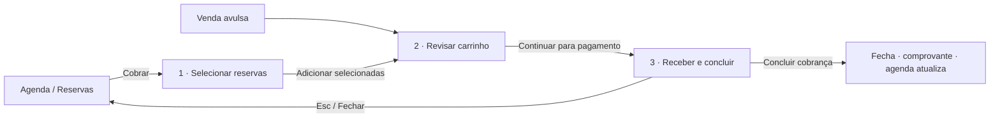

# Recepção — Checkout (cobrar reservas / receita avulsa)

| | |
|---|---|
| Status | implementada (documentação do comportamento atual) |
| Quem usa | recepcionista |
| Tema | claro |
| Padrão | [diálogo](../../04-padroes-de-tela/dialogo.md) em `CartaoModal` |
| Desenho aprovado | `Checkout.dc.html` |
| Código | `desktop/src/Kartodromo.Recepcao/Caixa.cs` (`FormCheckout`) |

## Objetivo
Receber o pagamento de uma ou mais reservas (ou de uma venda avulsa) em uma ou várias formas, com desconto,
acréscimo, voucher e troco.

## Fluxo

## Layout
Título "Cobrar reservas" (ou "Receita avulsa") · faixa de etapas 1–2–3 · coluna esquerda: reservas disponíveis ·
centro: carrinho com barra (Aplicar desconto, Aplicar acréscimo, Continuar para pagamento) · etapa 3: botões de forma de
pagamento (ícone + nome), campo valor, lista de pagamentos, "Falta lançar R$ x" · coluna direita: resumo (Total,
Desconto, Acréscimo, Subtotal, Valor recebido), cartão **Troco**, botão **Concluir cobrança**.

## Interações
| # | Elemento | Gatilho | Interface | Negócio | Destino |
|---|---|---|---|---|---|
| 1 | Pesquisar cliente | clique | abre busca de clientes | vincula o cliente | modal → volta |
| 2 | Cabeçalho da lista de reservas | clique | marca/desmarca todas | — | permanece |
| 3 | Adicionar selecionadas | clique | itens vão para o carrinho | — | permanece |
| 4 | Remover seleção / Limpar carrinho | clique | remove itens (limpar pergunta antes e zera pagamentos e voucher) | — | permanece |
| 5 | Aplicar desconto / acréscimo | clique | pede "10% ou 15,00" para os itens selecionados (ou todos) | recalcula totais | prompt → permanece |
| 6 | Voucher + Aplicar | clique / Enter | valida o código | abate do total | permanece |
| 7 | Continuar para pagamento | clique | ativa a etapa 3, foco no valor | — | permanece |
| 8 | Forma de pagamento (Pix, Crédito, Débito, Dinheiro, Outro) | clique | lança o valor digitado naquela forma | — | permanece |
| 9 | Concluir cobrança | clique | "Concluindo…" | grava pagamentos, baixa reservas, atualiza caixa | fecha; agenda atualiza |
| 10 | Fechar / Esc | clique | fecha; com itens no carrinho pergunta | nada gravado | volta à origem |

## Validações
| Campo | Regra | Momento | Mensagem |
|---|---|---|---|
| Forma de pagamento | carrinho com itens e etapa 3 ativa | ao lançar | "Adicione itens e avance para a etapa de pagamento." |
| Valor | > 0 | ao lançar | "Informe o valor." |
| Desconto/acréscimo | número ou % | ao aplicar | "Valor inválido." |
| Produto avulso | produto e preço válidos | ao adicionar | "Produto ou preço inválido." |
| Produto repetido | parâmetro `office.bloquearProdutosRepetidos` | ao adicionar | "Produto já está no carrinho." |

## Estados
| Estado | Aparência |
|---|---|
| Carrinho vazio | "Adicione itens para começar" |
| Pagamento parcial | "Falta lançar R$ x" |
| Completo | "Pagamento completo"; Concluir habilitado |
| Recebido a mais em dinheiro | cartão Troco mostra o valor |
| Terminal não aberto | pergunta "O terminal ainda não foi aberto, deseja abrir agora?" → `FormTerminalAbrir` |

## Regras
| Interface | Negócio |
|---|---|
| Etapas 1→2→3 visíveis e numeradas | Só conclui com valor recebido ≥ subtotal |
| Valores em R$ alinhados à direita, fonte numérica | Troco só existe em dinheiro |
| Concluir é o único primário | Pagamento só existe com terminal (caixa) aberto |
| Limpar carrinho pergunta "Remover todos os itens e pagamentos do carrinho?" | Estorno é outra tela (`FormEstorno`) |

## Teclado
Tab: busca de cliente → reservas → carrinho → valor → formas → Concluir. Enter no valor lança na forma selecionada. Esc fecha.

## Critérios de aceite
- [ ] Em 1280×720 nenhuma coluna, botão ou total aparece cortado.
- [ ] "Falta lançar" sempre corresponde a subtotal − recebido.
- [ ] Concluir com pagamento incompleto não grava nada.
- [ ] Troco aparece só quando há dinheiro recebido a mais.

## Divergências do padrão (a migrar)
Cores e fontes escritas direto no código (`Color.FromArgb(31, 68, 45)` do Troco, `new Font("Segoe UI", 9.2F)`), botões
de 34/36/38/56 px fora da escala P/M/G. Ver [inventário](../../10-inventario/divergencias-atuais.md).
